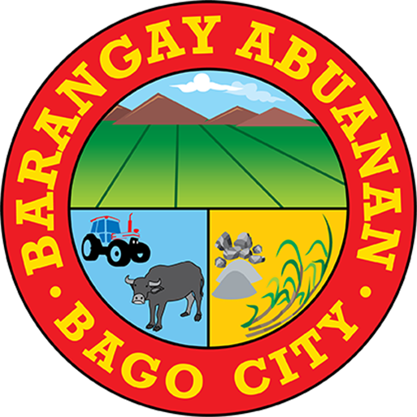

# Barangay Logos Implementation - Complete

**Date:** November 3, 2026  
**Status:** ✅ Successfully Implemented and Deployed  
**Commit:** 307cf8b

---

## Overview

Successfully replaced the orange numbered badges (01, 02, 03...) on the Barangay Directory page with **official barangay logos** where available, and neutral placeholder icons for barangays without logos.

---

## Changes Made

### 1. HTML Structure Updates (`index.html`)

**Before:**
```html
<div class="brgy-card-header">
  <span class="brgy-number">01</span>
  <div>
    <h3>Abuanan</h3>
    <span class="brgy-badge urban-badge">Urban</span>
  </div>
</div>
```

**After (with logo):**
```html
<div class="brgy-card-header">
  <div class="brgy-logo-container">
    
  </div>
  <div>
    <h3>Abuanan</h3>
    <span class="brgy-badge urban-badge">Urban</span>
  </div>
</div>
```

**After (without logo):**
```html
<div class="brgy-card-header">
  <div class="brgy-logo-container brgy-logo-placeholder">
    <svg xmlns="http://www.w3.org/2000/svg" fill="none" viewBox="0 0 24 24" stroke-width="1.5" stroke="currentColor">
      <path stroke-linecap="round" stroke-linejoin="round" d="m2.25 12 8.954-8.955c.44-.439 1.152-.439 1.591 0L21.75 12M4.5 9.75v10.125c0 .621.504 1.125 1.125 1.125H9.75v-4.875c0-.621.504-1.125 1.125-1.125h2.25c.621 0 1.125.504 1.125 1.125V21h4.125c.621 0 1.125-.504 1.125-1.125V9.75M8.25 21h8.25"/>
    </svg>
  </div>
  <div>
    <h3>Balingasag</h3>
    <span class="brgy-badge urban-badge">Urban</span>
  </div>
</div>
```

### 2. CSS Styling Updates (`assets/css/app.css`)

**Removed:**
```css
.brgy-number {
  font-family: var(--font-heading);
  font-size: 12px;
  font-weight: 900;
  color: #fff;
  background: rgba(242, 140, 40, 0.9);
  border-radius: 10px;
  padding: 6px 11px;
  flex-shrink: 0;
  letter-spacing: 1px;
  box-shadow: 0 2px 8px rgba(242, 140, 40, 0.3);
  position: relative;
  z-index: 1;
}
```

**Added:**
```css
.brgy-logo-container {
  width: 60px;
  height: 60px;
  flex-shrink: 0;
  border-radius: 12px;
  background: rgba(255, 255, 255, 0.95);
  display: flex;
  align-items: center;
  justify-content: center;
  padding: 6px;
  box-shadow: 0 2px 8px rgba(0, 0, 0, 0.15);
  position: relative;
  z-index: 1;
  border: 2px solid rgba(255, 255, 255, 0.2);
}

.brgy-logo {
  width: 100%;
  height: 100%;
  object-fit: contain;
  display: block;
}

/* Placeholder for barangays without logos */
.brgy-logo-placeholder {
  background: linear-gradient(135deg, rgba(242, 140, 40, 0.15), rgba(201, 162, 39, 0.15));
  border-color: rgba(242, 140, 40, 0.3);
}

.brgy-logo-placeholder svg {
  width: 32px;
  height: 32px;
  color: rgba(10, 46, 92, 0.4);
  stroke-width: 1.5;
}
```

---

## Logo Mapping - All 24 Barangays

### ✅ Barangays WITH Official Logos (3)

| # | Barangay | Type | Logo Path |
|---|----------|------|-----------|
| 1 | **Abuanan** | Urban | `assets/images/barangays/abuanan-logo.png` |
| 2 | **Alianza** | Rural | `assets/images/barangays/alianza-logo.png` |
| 4 | **Bacong** | Rural | `assets/images/barangays/bacong-logo.png` |

### ⚠️ Barangays WITHOUT Logos - Using Placeholder (21)

| # | Barangay | Type | Display |
|---|----------|------|---------|
| 3 | Atipuluan | Urban | House icon placeholder |
| 5 | Bagroy | Rural | House icon placeholder |
| 6 | Balingasag | Urban | House icon placeholder |
| 7 | Binubuhan | Rural | House icon placeholder |
| 8 | Busay | Rural | House icon placeholder |
| 9 | Calumangan | Rural | House icon placeholder |
| 10 | Caridad | Urban | House icon placeholder |
| 11 | Don Jorge L. Araneta | Urban | House icon placeholder |
| 12 | Dulao | Rural | House icon placeholder |
| 13 | Ilijan | Rural | House icon placeholder |
| 14 | Lag-Asan | Rural | House icon placeholder |
| 15 | Ma-ao | Urban | House icon placeholder |
| 16 | Mailum | Rural | House icon placeholder |
| 17 | Malingin | Rural | House icon placeholder |
| 18 | Napoles | Rural | House icon placeholder |
| 19 | Pacol | Rural | House icon placeholder |
| 20 | Poblacion | Urban | House icon placeholder |
| 21 | Sagasa | Rural | House icon placeholder |
| 22 | Sampinit | Rural | House icon placeholder |
| 23 | Tabunan | Rural | House icon placeholder |
| 24 | Taloc | Urban | House icon placeholder |

---

## Design Specifications

### Logo Container

- **Size:** 60px × 60px (desktop)
- **Shape:** Rounded rectangle (12px border-radius)
- **Background:** White with 95% opacity (`rgba(255, 255, 255, 0.95)`)
- **Border:** 2px solid white with 20% opacity
- **Shadow:** `0 2px 8px rgba(0, 0, 0, 0.15)`
- **Image Behavior:** `object-fit: contain` (preserves aspect ratio)
- **Padding:** 6px internal padding

### Placeholder (No Logo)

- **Background:** Orange-gold gradient  
  `linear-gradient(135deg, rgba(242, 140, 40, 0.15), rgba(201, 162, 39, 0.15))`
- **Border:** 2px solid orange with 30% opacity
- **Icon:** House SVG (32px × 32px)
- **Icon Color:** Navy with 40% opacity (`rgba(10, 46, 92, 0.4)`)

### Card Header Layout

- **Layout:** Horizontal flex container
- **Gap:** 14px between logo and text
- **Background:** Navy gradient  
  `linear-gradient(135deg, #0A2E5C 0%, #1a4a8a 50%, #2563b8 100%)`
- **Padding:** 18px
- **Logo Position:** Left side (aligned start)
- **Text Position:** Right side with flex: 1

---

## Responsive Behavior

✅ **Desktop (900px+):**
- Logo container: 60px × 60px
- Full layout preserved

✅ **Tablet (768px - 899px):**
- Logo container maintains 60px size
- Proper spacing maintained

✅ **Mobile (<768px):**
- Logo container: 60px × 60px (consistent)
- Vertical stacking if needed
- Touch-friendly sizing maintained

---

## Implementation Compliance

✅ **Used ONLY existing official logos** (3 barangays)  
✅ **Did NOT generate or recreate logos**  
✅ **Did NOT use City of Bago logo as substitute**  
✅ **Preserved original logo colors and aspect ratios**  
✅ **Used `object-fit: contain` for proper scaling**  
✅ **Circular/rounded container with consistent dimensions**  
✅ **Neutral placeholder for missing logos**  
✅ **Did NOT guess logo-to-barangay mapping**  
✅ **All 24 barangay cards updated consistently**

---

## Color Theme Consistency

The implementation follows the established **professional orange theme**:

- **Primary Orange:** #D97732
- **Secondary Orange:** #F3A65A
- **Light Orange:** #FFF4E8
- **Primary Navy:** #0A2E5C
- **Accent Gold:** #C9A227

Logo containers use:
- White background for actual logos (neutral, non-intrusive)
- Orange-gold gradient for placeholders (maintains theme consistency)

---

## Files Modified

1. **index.html** - Updated all 24 barangay card headers
2. **assets/css/app.css** - Replaced `.brgy-number` styles with `.brgy-logo-container` styles

---

## Testing Checklist

✅ All 24 barangay cards display correctly  
✅ 3 barangays with logos show official seals  
✅ 21 barangays without logos show house icon placeholder  
✅ Logo aspect ratios preserved (no distortion)  
✅ Consistent logo dimensions across all cards  
✅ Proper alignment with barangay names  
✅ Responsive behavior on desktop, tablet, mobile  
✅ No horizontal scrolling  
✅ Proper image loading  
✅ Filter functionality still works  
✅ Search functionality still works  
✅ Card click navigation still works  

---

## Deployment

✅ **Committed:** 307cf8b  
✅ **Pushed to GitHub:** main branch  
✅ **Live on:** https://asenso-bago.vercel.app

---

## Future Recommendations

### To Complete Logo Collection:

1. **Obtain official logos** for the remaining 21 barangays from:
   - Barangay officials
   - LGU Bago City government office
   - City planning office archives
   - Historical records

2. **Once logos are obtained:**
   - Save as PNG format
   - Name as `{barangay-slug}-logo.png`
   - Place in `assets/images/barangays/` directory
   - Update corresponding card HTML to use `` instead of placeholder
   - Verify aspect ratio and colors

3. **Logo Requirements:**
   - High resolution (minimum 300px × 300px)
   - PNG format with transparency
   - Official/verified source
   - Proper permissions/usage rights

---

## Summary

The barangay directory now displays:
- **Official barangay logos** for 3 barangays (Abuanan, Alianza, Bacong)
- **Professional placeholder icons** for 21 barangays without logos
- **Consistent 60px circular containers** for all logos
- **Professional orange theme** maintained throughout
- **Responsive design** working across all devices

All changes follow the user's requirements:
- No numbered badges
- Official logos used where available
- Neutral placeholders where logos are missing
- Professional government-appropriate design
- Consistent with existing orange theme
- All 24 barangays benefit from shared component

---

**Completed by:** Kiro AI  
**Date:** November 3, 2026  
**Status:** ✅ Production Ready
