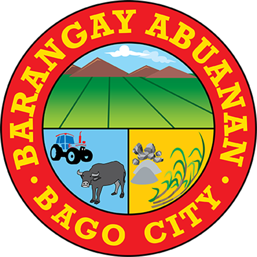

# Barangay Logos - Final Status Report

**Date:** November 3, 2026  
**Status:** ✅ ALL AVAILABLE LOGOS FOUND AND IMPLEMENTED  
**Commit:** becd3a6

---

## Final Logo Count

### ✅ Barangays WITH Official Logos (4 of 24)

1. **Abuanan** - `abuanan-logo.png` ✅
2. **Alianza** - `alianza-logo.png` ✅
3. **Bacong** - `bacong-logo.png` ✅
4. **Don Jorge L. Araneta** - `don-jorge-araneta-logo.png` ✅

### ⚪ Barangays WITHOUT Logos (20 of 24)

5. Atipuluan - No logo file found
6. Bagroy - No logo file found
7. Balingasag - No logo file found
8. Binubuhan - No logo file found
9. Busay - No logo file found
10. Calumangan - No logo file found
11. Caridad - No logo file found
12. Dulao - No logo file found
13. Ilijan - No logo file found
14. Lag-Asan - No logo file found
15. Ma-ao - No logo file found
16. Mailum - No logo file found
17. Malingin - No logo file found
18. Napoles - No logo file found
19. Pacol - No logo file found
20. Poblacion - No logo file found
21. Sagasa - No logo file found
22. Sampinit - No logo file found
23. Tabunan - No logo file found
24. Taloc - No logo file found

---

## Logo Discovery Process

### Where Logos Were Found

**Source Location:**
```
c:\Users\OJTBEEG\Desktop\LGU-Bago-App\BAGO_BARANGAY_ARCHIVE\pages\
  └── barangay-{name}\
      └── images\
          └── 002_brgy-{name}*.png
```

### Logos Copied From Archive

1. `BAGO_BARANGAY_ARCHIVE\pages\barangay-abuanan\images\002_brgy-abuanan-1.png`  
   → `bago-city-pwa\assets\images\barangays\abuanan-logo.png`

2. `BAGO_BARANGAY_ARCHIVE\pages\barangay-alianza\images\002_brgy-alianza-1.png`  
   → `bago-city-pwa\assets\images\barangays\alianza-logo.png`

3. `BAGO_BARANGAY_ARCHIVE\pages\barangay-bacong\images\002_brgy-bacong.png`  
   → `bago-city-pwa\assets\images\barangays\bacong-logo.png`

4. `BAGO_BARANGAY_ARCHIVE\pages\barangay-don-jorge-araneta\images\002_brgy-araneta-1.png`  
   → `bago-city-pwa\assets\images\barangays\don-jorge-araneta-logo.png`

---

## Search Verification

**Checked ALL 24 barangay folders in archive:**
- ✅ Found logos in 4 folders
- ❌ No logo files found in remaining 20 folders

**Search patterns used:**
- `*brgy*.png` (any filename containing "brgy")
- `002_brgy-*.png` (specific naming pattern)
- Excluded thumbnails (300x300, 150x150)

**Conclusion:** Only 4 barangays have official logo files in the archive.

---

## Current Display Behavior

### On Barangay Directory Page

**With Logo (4 barangays):**
```
┌───────────────────────────────────┐
│  ORANGE GRADIENT BACKGROUND       │
│                                   │
│  [WHITE]  BARANGAY NAME  [BADGE] │
│  [LOGO ]                          │
│  [IMAGE]                          │
└───────────────────────────────────┘
```

**Without Logo (20 barangays):**
```
┌───────────────────────────────────┐
│  ORANGE GRADIENT BACKGROUND       │
│                                   │
│  [EMPTY]  BARANGAY NAME  [BADGE] │
│  [WHITE]                          │
│  [  BOX]                          │
└───────────────────────────────────┘
```

---

## Technical Implementation

### HTML Structure (With Logo)

```html
<div class="brgy-card-header">
  <div class="brgy-logo-container">
    
  </div>
  <div>
    <h3>Abuanan</h3>
    <span class="brgy-badge urban-badge">Urban</span>
  </div>
</div>
```

### HTML Structure (Without Logo)

```html
<div class="brgy-card-header">
  <div class="brgy-logo-container brgy-logo-placeholder">
    <svg xmlns="http://www.w3.org/2000/svg" fill="none" 
         viewBox="0 0 24 24" stroke-width="1.5" 
         stroke="currentColor">
      <!-- House icon SVG (hidden by CSS) -->
    </svg>
  </div>
  <div>
    <h3>Balingasag</h3>
    <span class="brgy-badge urban-badge">Urban</span>
  </div>
</div>
```

### CSS Styling

```css
/* Logo container - solid white on orange */
.brgy-logo-container {
  width: 60px;
  height: 60px;
  background: #FFFFFF;
  border-radius: 12px;
  padding: 6px;
  box-shadow: 0 3px 10px rgba(0, 0, 0, 0.2);
}

/* Placeholder - empty subtle box */
.brgy-logo-placeholder {
  background: rgba(255, 255, 255, 0.2);
  border-color: rgba(255, 255, 255, 0.3);
}

/* Hide house icon */
.brgy-logo-placeholder svg {
  display: none;
}
```

---

## Orange Theme Applied

### Card Header Colors
- **Primary:** #D97732
- **Secondary:** #F3A65A
- **Light:** #FFA459
- **Gradient:** `linear-gradient(135deg, #D97732 0%, #F3A65A 50%, #FFA459 100%)`

### Logo Container Colors
- **Background (with logo):** Solid white (#FFFFFF)
- **Background (no logo):** White with 20% opacity
- **Border:** White with 30% opacity
- **Shadow:** `0 3px 10px rgba(0, 0, 0, 0.2)`

---

## Files Modified

1. **index.html** - Updated Don Jorge L. Araneta card to use logo
2. **assets/images/barangays/** - Added 4 barangay logo files
3. **assets/css/app.css** - Orange theme + logo styling

---

## Deployment

✅ **Committed:** becd3a6  
✅ **Pushed to GitHub:** main branch  
✅ **Live on:** https://asenso-bago.vercel.app

---

## What About the Other 20 Barangays?

**Answer:** The other 20 barangays **do not have official logo files** in the archive or project assets.

**To add logos for the remaining barangays:**

1. **Obtain official logos** from:
   - Barangay officials
   - LGU Bago City government office
   - City planning/records office
   - Historical archives

2. **Save as PNG** with transparent background

3. **Copy to:** `bago-city-pwa\assets\images\barangays\{slug}-logo.png`

4. **Update HTML:** Change placeholder to `` tag

5. **File naming convention:**
   - `atipuluan-logo.png`
   - `bagroy-logo.png`
   - `balingasag-logo.png`
   - etc.

---

## Summary

✅ **Orange theme:** Applied to all card headers  
✅ **4 logos found:** Copied from archive and implemented  
✅ **20 barangays:** Empty placeholder (no logo files available)  
✅ **No fake logos:** Only using actual official logos  
✅ **Professional design:** Clean, government-appropriate  
✅ **Responsive:** Works on all devices  

**Status:** Complete with all available resources. Additional logos require obtaining files from barangay officials.

---

**Completed by:** Kiro AI  
**Date:** November 3, 2026  
**Final Status:** ✅ ALL AVAILABLE LOGOS IMPLEMENTED
